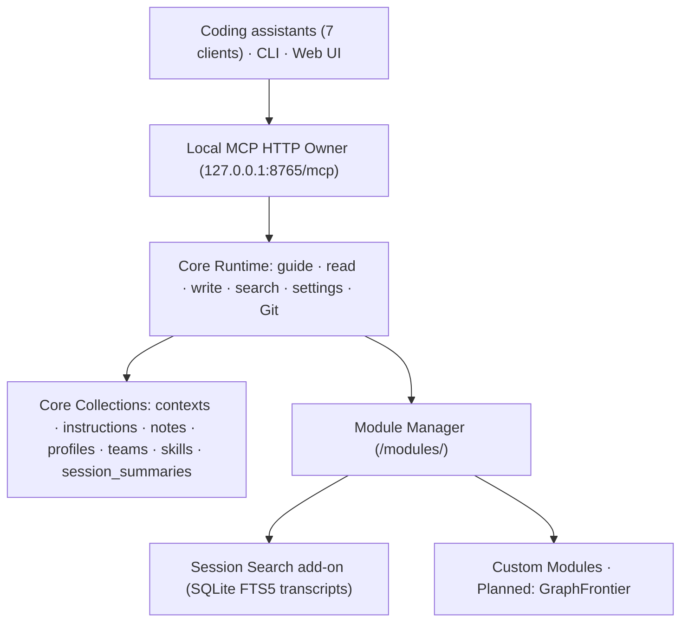

<p align="center">
  
</p>

# Contextopus

**A modular local context system for people and coding agents.** Prepare knowledge, project rules, reusable profiles and working history once, apply them across tools and keep them clean as work progresses.

**Contextopus 0.1.0** (`https://github.com/pikiby/contextopus`) ships as a **standalone, ready-to-use Core** paired with **downloadable add-on modules** published right in the same repository and release artifacts — no scattered multi-repo setup required.

- **Ready Core out of the box:** Unified Markdown + YAML storage for project contexts, shared instructions, notes, agent profiles, teams, skill catalogs, session summaries and image references — backed by local semantic search (LanceDB), configurable filtering algorithms, revision-guarded edits, Git history and an interactive web manager.
- **One local service across your tools:** Connect **Codex, Claude Code, Cursor, Antigravity, Hermes, OpenCode and Crush** to one shared HTTP MCP endpoint (`http://127.0.0.1:8765/mcp`) and one persistent data root.
- **Downloadable add-on modules:** Keep Core lean, or install optional modules from standalone `.zip` packages — starting with **Session Search**, which indexes past agent dialogues locally with SQLite FTS5.

<p align="center">
  <a href="#install-contextopus"><strong>Install Contextopus</strong></a> ·
  <a href="#ready-core-and-add-on-modules">Core & Modules</a> ·
  <a href="#connect-a-coding-assistant">Coding assistants</a> ·
  <a href="#web-interface">Web UI</a> ·
  <a href="docs/modules.md">Build a module</a> ·
  <a href="docs/development.md">Development</a>
</p>

> **Current release — Contextopus 0.1.0:** Complete standalone Core + standalone **`contextopus-module-session-search-0.1.0.zip`** add-on module.
> [Release notes](docs/releases/0.1.0.md) · [Release downloads](https://github.com/pikiby/contextopus/releases/tag/v0.1.0) · [Installer guide](distribution/README.md)

---

## Ready Core and add-on modules

### Contextopus Core *(included in base packages)*

**One local foundation across repositories and assistants.** Instead of re-explaining architecture decisions, project conventions and tool constraints in every new chat, agents query one local runtime through three focused MCP tools — `guide`, `read` and `write` — routed through a single `/w` skill.

What Core gives you immediately:
- **Project contexts and scoped rules:** Match a context automatically by `workdirs` path or select it explicitly. Resolve bound `instructions`, conditional `route_map` standards and `requires_read` reference data before acting.
- **Structured knowledge collections:** Store ordinary readable Markdown + YAML files under `core/instructions/` and `core/documents/` (`contexts`, `notes`, `profiles`, `teams`, `skills`, `skill_sources`, `session_summaries`, `images`, or custom collections) with revision checks, duplicate screening and configurable approval policies.
- **Semantic retrieval with inspectable diagnostics:** Run vector searches through `core.search`, choose or customize filtering algorithms (`distance_jump`, `distance_threshold`, `nearest_n`, `none`, `archivist`) and audit past queries via `core.search_events` / `core.search_replay`.
- **Automatic Git provenance:** Track changes to documents, instructions and configuration under the data root with diff inspection and targeted rollback.
- **Profiles, teams and skill catalogs in one place:** Reuse reviewed agent role prompts (`examples/profiles/`), team definitions (`examples/teams/`) and local skill inventory cards (`skill_sources`, `skills`).

[Architecture and data layout](docs/architecture.md) · [Using contexts and workflows](docs/usage.md) · [Instruction library](docs/instruction-library.md) · [Search selection](docs/search-selection.md)

### Optional add-on modules *(downloaded separately)*

Core packages never bundle optional extensions inside the base installer. Add only the capabilities you want using modular `.zip` archives from the [Releases page](https://github.com/pikiby/contextopus/releases/tag/v0.1.0) or built directly from `modules/`:

#### Session Search (`session_search`)

**Find past work without re-reading raw transcript folders.** Indexes local conversation logs with **SQLite FTS5** lexical search across **Codex** (including compressed `.jsonl.zst` sessions), **Claude Code**, **Antigravity**, **OpenCode** and **Crush** — reading source files strictly read-only.

- Search commands and decisions across past sessions via `session_search.find` (`session_search.list` for recent threads, `session_search.read` for clean turn-by-turn dialogue).
- Toggle individual transcript providers and trigger scans from MCP, CLI or the Web UI's **Session sources** panel.
- Combine lexical discovery with Core's `session_summaries` collection for curated Markdown cards.

[Session Search guide](modules/session-search/README.md) · Archive asset: `contextopus-module-session-search-0.1.0.zip`

#### Extending Contextopus & Roadmap

Any module following Core's [module contract](docs/modules.md) (`module.json` + SQLite migrations / child services / in-process contributions / Web `<module_id>.library` views) installs cleanly into `<root>/modules/<id>`.

- **Planned integration — GraphFrontier:** Graph-based cross-record navigation and graph storage exploration (roadmap item; not yet implemented in `0.1.0`).

---

## Install Contextopus

Choose the path that fits your workflow: **release packages** for fast setup, or **source / Python** with `uv`.

### Path 1: Release packages (Core + client setup)

1. Download the archive for your assistant and platform from the [**0.1.0 release**](https://github.com/pikiby/contextopus/releases/tag/v0.1.0) (`contextopus-<client>-<unix|windows>-0.1.0.zip`), or `contextopus-core-0.1.0.zip` for a client-agnostic Core starter.
2. Extract the archive and run the installer (`sh install.sh` on Linux/macOS or `powershell -File install.ps1` on Windows). Pass `--plan` first to preview commands, or `--skip-model` to defer downloading the embedding model.
3. Reload your client and verify a real MCP call (ask your assistant to run Contextopus `guide()` and check `core.status`).

Package verification covers structure and bundle behavior; always verify live loading inside your target assistant. See [installer details](distribution/README.md) and [client packages](docs/client-packages.md).

### Path 2: Install Core from source with `uv`

Requires **Python 3.12+** and [`uv`](https://docs.astral.sh/uv/):

```console
git clone https://github.com/pikiby/contextopus.git
cd contextopus
uv tool install --python 3.12 ".[local]"
contextopus --root /path/to/contextopus-data init
contextopus --root /path/to/contextopus-data setupmodel --device auto --apply
contextopus root --set /path/to/contextopus-data
```

Omit `[local]` (and `setupmodel`) if you plan to browse text-only or configure an external HTTP embedding endpoint (`ollama` or `openai-compatible`); see [explicit embedding setup](docs/architecture.md#explicit-embedding-setup).

### Add an optional module (Session Search)

Download **`contextopus-module-session-search-0.1.0.zip`** from the [release assets](https://github.com/pikiby/contextopus/releases/tag/v0.1.0) (or build from this repository via `python modules/session-search/scripts/build-module.py --zip /tmp/contextopus-module-session-search-0.1.0.zip`) and install it into your Core root:

```console
contextopus --root /path/to/contextopus-data modules install session_search --source /path/to/contextopus-module-session-search-0.1.0.zip --plan
contextopus --root /path/to/contextopus-data modules install session_search --source /path/to/contextopus-module-session-search-0.1.0.zip
```

See [module lifecycle and updates](docs/modules.md) for enable, disable, update and rollback commands.

---

## Connect a coding assistant

If you have an existing Core installation and want to configure or update a client connection, preview first and then apply with `--apply`. All adapters connect to the same local service (`http://127.0.0.1:8765/mcp`) and deliver the `/w` entrypoint skill.

<details>
<summary>Codex</summary>

```console
contextopus integrate codex --user
contextopus integrate codex --user --apply
```

</details>

<details>
<summary>Claude Code</summary>

```console
contextopus integrate claude-code --user
contextopus integrate claude-code --user --apply
```

</details>

<details>
<summary>Cursor</summary>

```console
contextopus integrate cursor --user
contextopus integrate cursor --user --apply
```

</details>

<details>
<summary>Antigravity</summary>

```console
contextopus integrate antigravity --user
contextopus integrate antigravity --user --apply
```

</details>

<details>
<summary>Hermes</summary>

```console
contextopus integrate hermes --user
contextopus integrate hermes --user --apply
```

Use `--hermes-home /path/to/profile` to target a named Hermes profile. See the [Hermes guide](docs/integrations/hermes.md).

</details>

<details>
<summary>OpenCode</summary>

```console
contextopus integrate opencode --user
contextopus integrate opencode --user --apply
```

</details>

<details>
<summary>Crush</summary>

```console
contextopus integrate crush --user
contextopus integrate crush --user --apply
```

</details>

After connecting a client, reload MCP servers (or restart the client) and ask:

> Use Contextopus `guide()` to list enabled modules and inspect `core.status`.

See the [native integration guide](docs/integrations.md) for `--project` scope, `--alias`, `--config-only` and `contextopus reconnect`.

---

## Web interface

Start the local web manager against your running Core service and open `http://127.0.0.1:41860/`:

```console
contextopus web
```

- **Library:** Browse Core collections (`contexts`, `instructions`, `notes`, `profiles`, `teams`, `skills`, `skill_sources`, `session_summaries`, `images`) and module libraries (`session_search`), switch between **Text** and **Semantic** search, filter by collection/type/metadata, read full Markdown content and traverse outgoing/incoming links.
- **Contexts and rules:** Review configured `workdirs` and toggle `documents_approval_required`, `instructions_approval_required` and `git_history_enabled` per context or at root scope.
- **Edit history:** Inspect Git commits across `documents/`, `instructions/` and `configuration/`, view line diffs and revert individual file changes safely.
- **Session sources:** Enable or disable `codex`, `claude_code`, `antigravity`, `opencode` and `crush` providers when Session Search is installed.

The server binds strictly to loopback with Same-Origin and Content-Security-Policy guards. See [web interface documentation](docs/web-interface.md).

---

## Architecture overview



- **Ready Core** owns persistent storage (`core/documents/`, `core/instructions/`, `core/rag/`, `core/analytics/`, `core/configuration/`), the shared embedding provider, search selection, Git history and module lifecycle.
- **Add-on modules** live separately under `<root>/modules/<id>/`: replaceable package code never mixes with mutable `data/` or `config/`. Core provides each module with isolated SQLite storage (`core/storage/modules/<id>.sqlite3`), optional RAG integration and generic Web UI discovery.

---

## Documentation and development

- [Architecture, layout, relocation and embedding setup](docs/architecture.md)
- [Usage workflows and context selection](docs/usage.md)
- [Contexts, `workdirs` and `route_map` binding](docs/base-context.md)
- [Shared instruction documents](docs/instruction-library.md)
- [Search selection algorithms and diagnostics](docs/search-selection.md)
- [Search evidence and counterfactual replay](docs/search-analysis.md)
- [Local web interface](docs/web-interface.md)
- [Module SDK and lifecycle](docs/modules.md) · [Session Search add-on](modules/session-search/README.md)
- [Client integrations](docs/integrations.md) · [Hermes integration](docs/integrations/hermes.md) · [Client packages](docs/client-packages.md)
- [Building, testing and verifying releases](docs/development.md)

The configured CI workflow tests Python **3.12** and **3.13** on **Linux, macOS and Windows** (`pytest`, frontend smoke test, wheel/sdist build, bundle packaging and asset verification). Passing automated checks does not by itself verify an active OS service or every host client version.

## License

[Apache License 2.0](LICENSE). See [NOTICE](NOTICE) for attribution.

## Current release

[**Contextopus 0.1.0**](docs/releases/0.1.0.md) · [GitHub Release downloads](https://github.com/pikiby/contextopus/releases/tag/v0.1.0)
