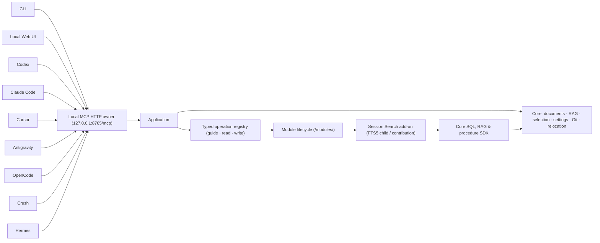

# Contextopus architecture

One installed Core Python runtime owns model/provider pools, shared vector search, Markdown/YAML collections and SQLite module databases. CLI, the local web manager and all seven supported coding assistants dispatch the same Application operations through one local HTTP owner. Import, status and procedure reads never download or load an embedding model. Local embeddings (`sentence-transformers`) are an explicit optional installation extra (`".[local]"`), and provider/profile selection lives at Core root scope and is shared across collections and modules.

Persistent data belongs in an explicit data root or the platform user-data directory (`platformdirs`), outside plugin caches and source checkouts. Core itself bundles context management, shared instructions, project notes, agent profiles/teams, skill catalogs, session summaries, image metadata, search evidence and Git history — without requiring external plugins for daily knowledge workflows.

## Components and extension boundaries

| Component | Role |
|---|---|
| **Ready Core (`contextopus`)** | Unified document collections (`core/instructions/` and `core/documents/<collection>/`), named project contexts (`workdirs`, `route_map`, `requires_rule`, `requires_read`), shared LanceDB RAG, filtering & selection diagnostics, operation journal, Git history, settings and root relocation. |
| **MCP interface** | Three primary tools: `guide()` (router, procedures, schemas), `read()` (queries) and `write()` (mutations under preview/revision/approval contracts). Optional legacy compatibility aliases via `CONTEXTOPUS_LEGACY_TOOLS=1`. |
| **CLI & Web UI** | Thin views and local controls over the shared Core application (`contextopus web` at `http://127.0.0.1:41860/` with Library, Contexts and rules, Edit history diffs/revert and Session sources). |
| **Session Search *(optional add-on module)*** | Separately downloadable archive (`contextopus-module-session-search-<version>.zip`) indexing local Codex (`.jsonl` / `.jsonl.zst`), Claude Code, Antigravity, OpenCode and Crush transcripts read-only with SQLite FTS5. |
| **GraphFrontier *(planned roadmap)*** | Planned future integration for graph-oriented navigation and storage; not implemented in `0.1.0`. |

## Data root layout

Under an initialized root directory:

- `core/instructions/` — shared instruction Markdown files (`type: instruction`).
- `core/documents/<collection>/` — built-in (`contexts`, `notes`, `profiles`, `teams`, `skills`, `skill_sources`, `session_summaries`, `images`) and custom validated document collections.
- `core/rag/` — active embedding configuration (`active.json`) and LanceDB vector index tables.
- `core/analytics/` — SQLite operation journal and bounded `search_evidence` snapshots (`operations.sqlite3`).
- `core/configuration/` — root, module (`modules/<module>.json`) and context (`contexts/core/<context>.json`) settings and module enablement state (`modules.json`).
- `core/storage/modules/` — one Core-managed SQLite database file per module (`<module-id>.sqlite3`).
- `modules/<id>/` — optional add-on modules keeping replaceable package code (`package/` + `module.json`) separate from mutable `data/` and `config/`.
- `.git/` — local Git history tracking changes in `documents/`, `instructions/` and `configuration/` (excluding `analytics/`, `rag/`, `storage/` and `tmp/` via `.git/info/exclude`).

## Relocation and root safety

Relocation (`contextopus relocation DEST --apply` / `core.relocation_plan` -> `core.relocation_apply`) copies files, validates SQLite integrity and records a destination receipt. The source remains frozen rather than silently forwarding requests: restart/rebind the service explicitly against the destination directory.

Each relocation preserves original database bytes and sidecars under `.backups/relocations/<snapshot-id>/` with snapshot identity retained across retries; legacy `core/relocation/raw/` trees are copied byte-for-byte as archives rather than re-opened as live databases.

On Windows, the protocol holds the root advisory guard continuously, acquires legacy locks around supported writers and writes the durable freeze before closing handles and renaming directories (`FILE_RENAME_INFORMATION` constraints require no competing handle to an open child entry).

## Module lifecycle and shared storage

Folder modules under `modules/<id>/` declare capabilities in `module.json`: metadata, `core_requires` (PEP 440), optional in-process `contribution` factory (plus `requires`) or child/service handlers, SQLite `storage` migrations (`001-*.sql`), router `routes` and `steps`, `procedures`, `skills`, `filter_algorithms`, `provider_settings` and Web UI `<module_id>.library` queries.

Discovery reads manifests passively without running module code or migrations. Explicit `install` / `update` stages checked payloads, runs dependencies/migrations and activates the module atomically (`disable` withdraws contributed operations, procedures, skills and algorithms while preserving `data/` and SQLite files). See [Module SDK and lifecycle](modules.md).

Core coordinates writers and transactions per module SQLite file, while vector indexing runs asynchronously or via explicit reconcile — there is no cross-store transaction spanning SQLite and LanceDB, so background indexers use durable state for safe replay.

## Explicit embedding setup

Semantic indexing is opt-in and transparent:

- `contextopus setupmodel --hardware` runs a read-only PyTorch/CUDA/MPS diagnostic without downloading or loading weights.
- `contextopus setupmodel --device auto` previews validated provider, profile and chunking parameters (`auto` selects available CUDA, then MPS, then CPU; explicitly requesting an unavailable accelerator fails closed).
- `--config provider-profile.json` and `--chunking chunking.json` configure local `sentence-transformers` (default `Qwen/Qwen3-Embedding-0.6B`, 1024 dimensions, chunk size 512 tokens, 64 overlap) or remote HTTP providers (`ollama` via `/api/embed` and `openai-compatible` via `/v1/embeddings` with explicit `huggingface` or `tiktoken` tokenizers and env-var `api_key_env` references — literal API keys are never stored).
- `--apply` (`core.model_apply`) rebuilds enabled RAG sources into an inactive table and swaps atomically on success, preserving existing data if build/provider fails.

Device probes follow PyTorch [CUDA](https://docs.pytorch.org/docs/stable/generated/torch.cuda.is_available.html) and [MPS](https://docs.pytorch.org/docs/stable/backends.html) availability checks. Inference behavior remains a separate runtime verification step.
