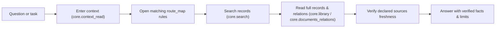

# Using Contextopus

Contextopus gives your coding assistants and workflows one shared persistent store of project contexts, rules, notes, profiles, skills and session summaries. CLI, the local Web UI (`http://127.0.0.1:41860/`) and all seven connected coding assistants operate on the exact same storage and service.

The examples below illustrate common patterns; replace `release-tools` and sample file paths with your actual project context.

## Entrypoint and routing (`/w` and `guide()`)

In coding clients where skills are installed, invoke **`/w`** (or **`$w`** in Codex) with your request, or ask your assistant to call **`guide()`** first.

- `guide()` returns Core's base rules, active module routes and mandatory workflow steps.
- `guide(procedure="work")` (and `setup`, `embeddings`, `modules`, or a module procedure like `session_search/search`) loads complete task instructions along with the schemas of declared operations.
- `guide(operation="core.search")` looks up one unfamiliar operation signature on demand.
- `read(operation=..., arguments=..., context=...)` dispatches queries; `write(operation=..., arguments=..., context=...)` dispatches mutations.

---

## Enter or find a project context

Every project can have its own named Markdown record under `core/documents/contexts/`. Contexts can declare working directories (`workdirs`), required rules (`requires_rule` / `instructions`), conditional task rules (`rule_routes` -> returned as `route_map`) and reference data (`requires_read`).

1. If you already know the context ID/slug or current working directory, read it in one step:

```json
{"operation": "core.context_read", "arguments": {"cwd": "/home/user/projects/release-tools"}}
```

2. Or browse/search existing contexts first via `core.library(action="records", collection="contexts")` or `core.search`.
3. `core.context_read` returns:
   - `context`: the context Markdown record and revision
   - `settings`: effective context overrides (`documents_approval_required`, `instructions_approval_required`, `git_history_enabled`, `selection`, etc.)
   - `rules`: all bound instruction bodies resolved in dependency order (`rules_revision`)
   - `route_map`: topic-specific rules (`when`, `target`, `path`); open every matching `route_map` entry with `core.library(action="record", ...)` before acting on that sub-problem
   - `required_reads`: resolved reference documents marked `"data_only"` (read as context data, never treated as active instructions)

If no matching context exists yet, do not invent one silently — ask the user to confirm context boundaries, `workdirs` and approval settings before creating a context document.

---

## Search knowledge and check evidence



Search returns ranked candidates along with algorithm diagnostics (`eligible_documents`, `considered_documents`, `selected_materials`, boundary cuts and truncation flags). Reading a candidate via `core.library(action="record", collection=..., id=...)` retrieves its full body, YAML metadata and resolved incoming/outgoing links (`core.documents_relations` inspects graph links directly).

Key habits for accurate retrieval:
- **Check diagnostics before assuming emptiness:** If `candidate_pool_truncated` or `result_window_complete: false` is set, inspect [selection boundaries and settings](search-selection.md) rather than blindly changing global defaults.
- **Check links and sources directly:** Distance rankings never prove correctness or currency. Verify cited files, commands or logs in the real workspace when making decisions.

---

## Preview and save changes safely

All writes through Core go through an explicit two-step preview -> commit pipeline (`core.documents_preview` -> `core.documents_save` / `core.documents_delete`):

1. **Preview first (`read` tool):**

```json
{
  "operation": "core.documents_preview",
  "arguments": {
    "collection": "notes",
    "path": "release-tools/retry-policy.md",
    "metadata": {
      "id": "retry-policy",
      "type": "decision",
      "title": "Queue retry interval",
      "description": "Why the exponential backoff cap is 30 seconds"
    },
    "content": "## Decision\n\nCap queue retries at 30 seconds after verified soak test.\n",
    "expected_revision": "<current-revision-or-null>",
    "action": "save"
  }
}
```

Preview checks:
- Exact `expected_revision` (rejecting stale overwrites; `null` is required when creating a new file).
- Nearby candidates (`similar` documents in the same collection/prefix) to catch duplicates before saving.
- A unified diff against the existing file and the effective `action_contract` (`approval_required`, `change_revision`).

2. **Follow the `approval_required` policy:**
   - Default Core settings require explicit user confirmation on instructions (`instructions_approval_required: true`) while allowing scoped document saves without separate confirmation (`documents_approval_required: false`) unless turned on per root or context in settings or the Web UI.
   - When `approval_required` is `true`, present the target path and diff to the user, wait for explicit approval, and pass `"approval": {"change_revision": "<from preview>", "confirmation": "<user reply>"}` to `core.documents_save` or `core.documents_delete`.

Every committed write updates disk Markdown atomically, updates or marks index status and creates an automatic local Git commit when `git_history_enabled` is true.

---

## Collections for profiles, teams, skills and sessions

Core includes dedicated collections alongside `contexts`, `instructions` and `notes`:

- **`profiles` and `teams`:** Store reusable agent system prompts (`examples/profiles/git-reader.md`) and team compositions (`examples/teams/development.md`). Search by meaning, read the full profile record, and invoke your coding assistant's native subagent mechanism if supported.
- **`skill_sources` and `skills`:** Document locally available skills and workflows so agents discover verified entrypoints without duplicating external files. Open referenced host `SKILL.md` paths natively before executing host skills.
- **`session_summaries` and `images`:** Save durable session takeaways and indexed descriptions of screenshots/diagrams stored locally.

---

## Manage contexts and history in CLI and Web UI

Inspect or operate on your bound root from any terminal:

```console
contextopus status
contextopus service status
contextopus doctor
contextopus modules
contextopus web
```

Override the root or context per command with `--root /path/to/data` or `--context my-project` before the subcommand, or invoke Core operations directly:

```console
contextopus query core.modules
contextopus query core.search --arguments '{"query": "retry policy", "collection": "notes"}'
```

Open **`http://127.0.0.1:41860/`** (via `contextopus web`) to search visually, read records with clickable wiki links, adjust approval/Git toggles under **Contexts and rules**, inspect diffs and revert files under **Edit history**, or manage **Session sources** when [Session Search](../modules/session-search/README.md) is installed.
